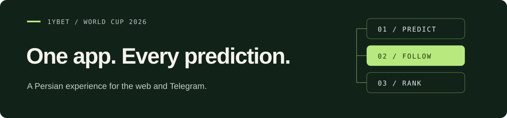
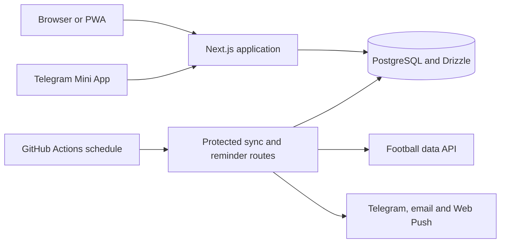

# 1ybet · World Cup 2026 Predictor

A Persian World Cup score-prediction app delivered as an installable **PWA** and a **Telegram Mini App**. The same Next.js application and PostgreSQL database power both clients, including linked accounts, predictions, rankings, and match notifications.

**Next.js · TypeScript · PostgreSQL · Drizzle · Telegram Mini Apps**

## Features

- **Predictions and brackets:** match-score entry, kickoff locking, and a separate interactive knockout-bracket predictor.
- **Tournament views:** knockout results, group standings, member rankings, head-to-head comparisons, and achievement badges.
- **Account continuity:** Telegram `initData` verification and phone-based account linking share the web identity.
- **Notifications:** Telegram updates, optional email reminders through Resend, and Web Push support.
- **Persian UX:** RTL layouts, Jalali dates, Persian digits, and the `Asia/Tehran` timezone.
- **Administration:** match-result overrides, data synchronization, tournament entry records, and notification tools.

The repository includes an opt-in entry-fee tournament model. This README describes the implementation; it does not announce an active competition or payment collection.

## Architecture



The scheduled workflow calls the application's protected routes approximately every five minutes. GitHub Actions scheduling can be delayed; it is not a real-time clock.

### Scoring

| Outcome | Group stage | Knockout stage |
| --- | --- | --- |
| Exact score | 10 | 20 |
| Correct goal difference | 7 | 14 |
| Correct winner | 5 | 10 |
| Participation | 2 | 4 |

Score predictions use the **90-minute result**. Knockout advancement uses the actual advancing team, including extra time and penalties. Tournament rankings count predictions within the configured tournament window.

## Run locally

Use a Node.js runtime compatible with the Next.js version in [package.json](package.json), plus npm and a PostgreSQL database.

```bash
git clone https://github.com/sobhanashine/1ybet.git
cd 1ybet
npm ci
cp .env.example .env.local
```

Configure the variables below, then prepare a development database:

```bash
npm run db:migrate
npm run seed
npm run dev
```

Open [localhost:3000](http://localhost:3000). Seed only a disposable development database: the seed command writes application and sample-match data.

### Configuration

| Variables | Purpose |
| --- | --- |
| `DATABASE_URL`, `DIRECT_URL` | Application database and migration connection |
| `SESSION_SECRET`, `OTP_CODE` | Session signing and the current fixed-code phone flow |
| `APP_URL` / `NEXT_PUBLIC_APP_URL` | Public origin for generated links |
| `FOOTBALL_DATA_API_KEY` | Fixture and result data |
| `CRON_SECRET` | Protect synchronization and reminder endpoints |
| `TELEGRAM_BOT_TOKEN` | Telegram identity, bot commands, and notifications |
| `RESEND_API_KEY`, `RESEND_FROM` | Optional email delivery |
| `VAPID_PUBLIC_KEY`, `VAPID_PRIVATE_KEY`, `NEXT_PUBLIC_VAPID_PUBLIC_KEY`, `VAPID_SUBJECT` | Optional Web Push |
| `NEXT_PUBLIC_TOURNAMENT_VIDEO_URL` | Optional tournament video |

`.env.example` contains the provider settings; the origin override is read in [lib/config.ts](lib/config.ts). Keep database credentials, signing keys, and provider secrets on the server.

**Authentication boundary:** the current phone flow returns a fixed code for on-screen display and does not deliver SMS. Replace it with real per-challenge SMS verification before relying on it to prove phone ownership. Telegram's signed `initData` verification is a separate flow. Implementation: [phone actions](app/actions/auth.ts) and [auth helpers](lib/auth.ts).

## Commands

| Command | Purpose |
| --- | --- |
| `npm run dev` | Development server |
| `npm run lint` | ESLint |
| `npm run build` | Next.js production build |
| `npm start` | Serve the production build |
| `npm run db:generate` | Generate schema migrations |
| `npm run db:migrate` | Apply migrations to the selected database |
| `npm run seed` | Populate a development database |
| `npm run bot:setup -- https://your-app.example` | Register the webhook, Mini App menu, and bot commands |

The bot setup command changes the configured Telegram bot. Use the intended bot token and HTTPS application origin.

## Deployment and scheduling

The application is configured for Vercel and PostgreSQL. Set the server environment, apply the intended migrations, and register Telegram at `/api/webhook/telegram` with the setup script.

For scheduled sync, set repository Actions secrets `APP_URL` and `CRON_SECRET`; the latter must match the deployed value. [.github/workflows/sync.yml](.github/workflows/sync.yml) calls `/api/cron/sync` and `/api/cron/reminders` using the `x-cron-secret` header. Missing or incorrect secrets are rejected by the routes.

## Repository map

```text
app/                    Pages, server actions, and API routes
app/actions/auth.ts     Phone and Telegram account flows
app/api/cron/           Protected result sync and reminder routes
lib/auth.ts             Sessions, phone helpers, Telegram verification
lib/config.ts           Shared configuration and public origin
lib/db/                 Database client and Drizzle schema
scripts/                Seed, webhook setup, and operational helpers
.github/workflows/      External synchronization schedule
```

Additional implementation notes: [agent notes](docs/AGENT_NOTES.md) · [API audit record](docs/audits/live-api-2026-07.md).

---

By [Sobhan Ashineh](https://github.com/sobhanashine) · [Full portfolio at FMS](https://futuremservices.ir/en/work)
